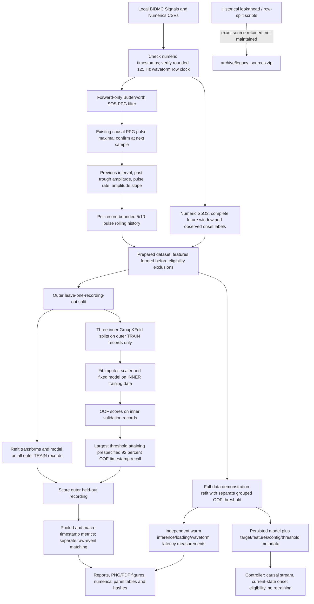

# Full pipeline guide

**Study-stage notice:** the core training diagram and recall-oriented metrics below document the earlier pipeline. The final planned evaluation is the [alarm-budget experiment](ALARM_BUDGET_EXPERIMENT.md), summarized and reconciled in [FINAL_REPORT.md](FINAL_REPORT.md). It uses training-only threshold selection on the saved nested scores, audited one-to-one alarm-start matching and separate outputs in `results/alarm_budget_experiment/run02/`. All four learned models detected 0/14 eligible 30-second events (0/15 at shorter tested windows) under all tested budgets. Research assumptions of 1/5/10 false starts per evaluable hour and a 5% active cap are not clinical standards; some outer constraints failed. Historical diagrams/figures and 14/14 reusable-positive sensitivity are not final-budget performance or proof of early warning.

Read the root README first. The first command is `python -m src.check_project --audit`. It is a fast read-only environment/source audit. Earlier recall-policy output is **results/final/{future_low,new_onset}/**. The historical `validated` and `hardened` runs remain evidence, not alternate active pipelines.

## Data flow and leakage boundaries



SpO₂ and future outcomes NEVER enter the predictor matrix. Current SpO₂ is used only for onset eligibility and ground truth. Test outcomes never choose thresholds or hyperparameters. Diagnostic figures/permutation analysis do not feed back into the evaluated model.

## Signals, timestamps, peaks and features

The local data comprise 30 paired eight-minute recordings. `Signals.csv` contains PLETH/PPG, RESP and ECG channels; this project uses PPG, not ECG, for prediction. RESP is visualized for context, not added as an unvalidated predictor. Peaks in the figures are **PPG pulse maxima, not ECG R peaks**. There is no added ECG detector solely for presentation.

Waveform export times lose precision after 100s. There are 60,001 rows per file at nominal 125Hz; the pipeline reconstructs `first_time + row_index/125` only when every exported time agrees within 0.005001s. It never deduplicates those acquisition samples. Numeric times retain their supplied coordinate, including record 23 starting at -1s; independent waveform/numeric rebasing is avoided. This checks export consistency, not unknown physical monitor delay.

The third-order 0.5–5Hz Butterworth filter runs forward only with zero initial state. Unlike the historical forward/backward filter, it cannot use future waveform data. A local maximum requires its following sample for confirmation (8ms at 125Hz), minimum past-trough amplitude 0.03 and a 0.30s refractory interval. The preceding accepted peak determines interval; intervals above 2s are rejected and counted. PPG amplitude uses the observed preceding trough. Features are timestamped at confirmation rather than backdated to the peak.

Pulse rate is 60 divided by the previous pulse interval in seconds. Amplitude slope is the change in amplitude divided by that interval. These are derived quantities: pulse rate and interval are not independent physiological measurements. Morphology/dicrotic peaks can still create ambiguous maxima. There are no ground-truth pulse annotations to establish peak detection sensitivity. Accepted interval/rate histograms and rejection counters are signal-quality proxies, not a validated SQI.

The ordered inputs are:

1. PPG_Amplitude (a.u.)
2. Pulse_Interval_s (s)
3. Pulse_Rate_BPM (beats/min)
4. Amplitude_Slope (a.u./s)
5. Rate_Mean_5 (beats/min)
6. Rate_Std_10 (beats/min)
7. Rate_Change_5 (beats/min)
8. Amplitude_Mean_5 (a.u.)
9. Amplitude_Std_10 (a.u.)
10. Interval_Std_10 (s)

Rolling windows count pulses, not seconds. Means use available history, singleton sample standard deviations initialize to zero, and the five-pulse difference is zero until six pulses exist. A bounded ten-pulse state resets per recording. Features are computed before target exclusions, retaining history through low-saturation and unavailable-target periods. Training-only median imputation handles missing measurements; scalers are fitted only on the permitted training fold. Neither centered windows nor backward filling are used.

## Ground truth

**future_low:** minimum valid observed SpO₂ in `(t,t+HORIZON]` is at or below `SPO2_THRESHOLD` (defaults 30s and 94%). The current observation is excluded. Future coverage must reach the horizon, have no gaps over 1.01s, no missing/invalid SpO₂, and remain within the recording. Unavailable labels are unknown, never automatically negative. Ongoing lows are included.

**new_onset:** the latest current observation must be valid, no more than 1.01s old and above 94%. A qualifying future onset is the first valid reading ≤94% immediately following a valid reading >94%, no more than 1.01s apart. A single reading suffices; there is no minimum persistence or preceding-normal washout. Initial/chronic low episodes and low readings after unknown measurements are not verified onsets. Complete valid future coverage is still required.

On complete current-normal windows the two binary labels agree; the onset model is trained on that eligible population instead of being trained on ongoing lows. Four all-low recordings have no onset-eligible rows; they are reported as empty for that target rather than excluded because of model performance. Records 17/29 have very small, all-positive eligible snippets; they remain included and flagged.

An episode with an observed 91 or 92 reading belongs to a descriptive severe-interest subset. The models do not predict exact saturation or a clinically adjudicated severe event. Missing ground truth is not invented.

## Models and validation

`src/model.py` contains the ELM and all baseline wrappers. Every model receives the identical ten features and target-eligible rows; each inner/outer fit has its own training-only imputer/scaler.

For ELM, `H = tanh(XW + b)` with fixed-seed random W and b; output weights solve weighted ridge least squares using Cholesky factorization of `H.T D H + ridge I`. There is no explicit inverse or gradient-trained hidden layer. Default: 50 hidden units, ridge 1, positive weight 5, seed 42. Its output is an uncalibrated score and may lie outside [0,1].

Logistic regression learns a regularized linear log-odds function, C=1, with balanced class weights. Gaussian naive Bayes estimates class-conditional means/variances under an independence assumption, equal priors and variance smoothing 1e-6. The decision tree has depth 3, minimum leaf size 50 and balanced weights. Weighted/equal-prior classifier outputs are not validated calibrated physiological probabilities.

The outer loop holds out a whole recording. Three inner GroupKFold fits produce one OOF score for each outer-training row. The largest threshold attaining the fixed 92% validation timestamp-recall objective is selected using those OOF scores, then the model is refitted on all outer-training rows and scored on the held-out recording. No feature/hyperparameter search takes place. OOF threshold transfer to a refitted model does not guarantee recall on another recording.

`per_record_predictions.csv` contains held-out scores/thresholds/decisions. Full-data `models/*.joblib` are demonstration refits with separate full-data OOF thresholds; they did NOT produce held-out metrics. Never score those full-data models on their training records and call it test performance.

Pooled metrics aggregate timestamp counts. Macro metrics average defined recording metrics, with explicit denominator counts. Recall is undefined on negative-only recordings, specificity on all-positive recordings, and precision when there are no alerts. NaN does not silently become zero. AP is average precision, not trapezoidal PR area. Pooled score curves combine different refits; per-record metrics are also needed. Recording groups are not proof of independent patient identity.

## Event and alarm metrics

This subsection retains the historical reusable-positive and false-target-run definitions. For the final one-to-one start metric, strict exposure, false-start rates and time-weighted active fraction, use the final reports linked above; the definitions are not interchangeable.

Event sensitivity counts qualifying observed onsets with a complete valid RAW 30s lead-in and at least one eligible prediction opportunity in `[onset-30,onset)`. An alert at onset is too late. First alert determines lead time, and available opportunity coverage is saved. Some recurring onsets follow brief recoveries, so eligible lead time can be much less than 30s. Nearby events may share an alert: this is not one-to-one event precision. The historical 13-event dense-coverage denominator differs from the current 14-opportunity denominator; that change is not improved detection.

False alarm episodes are positive runs split by a negative decision or >2s gap; a run is false if it contains no positive target timestamp. Exposure sums adjacent eligible pulse intervals ≤2s, excluding most unavailable/current-low periods, but may bridge shorter excluded gaps. This is approximate evaluable exposure, not total recording duration. FP timestamps, episode starts and alert fraction answer different questions. Always-alert can have perfect event sensitivity and few episode starts while being useless.

## Exact file map

| Path | Role / reads → produces | Called by | Edit for |
|---|---|---|---|
| `src/__init__.py` | Core package marker; no data I/O | Python module discovery | Normally leave alone |
| `src/config.py` | Core: paths, target semantics, feature order, seeds, fixed model/timing configuration | All core modules | Target/parameter changes, before an independently evaluated run |
| `src/dataset.py` | Core: raw CSVs → full pulse histories, named labels, selected prepared dataset and audits | Runner/provenance, dataset CLI | Loading/schema/stage reporting |
| `src/preprocessing.py` | Core: waveform times/PPG → verified clock, causal filter and pulse confirmation | Dataset, controller, figures | Signal processing / detector; test prefix equivalence |
| `src/features.py` | Core: latest pulse and bounded history → ten ordered predictors | Dataset, controller | Causal feature definitions |
| `src/labeling.py` | Core: numeric time/SpO₂ → complete-window labels, onset eligibility, episodes | Dataset | Ground-truth semantics; never tune against outer outcomes |
| `src/provenance.py` | Core: source/code/artifact fingerprints → verified cache receipt | Runner, quality gate | Cache schema/dependencies |
| `src/model.py` | Core: training features/labels → ELM or sklearn baselines plus transforms; trusted persistence | Evaluation, runner, controller | Model implementation; fixed comparison settings remain in config |
| `src/evaluation.py` | Core: groups/scores/labels → outer/inner splits, OOF thresholds, metrics, alarm statistics | Runner, tests, reports | Validation/metric policy |
| `src/run_experiments.py` | Core CLI: raw/prepared data → all fixed-model predictions, metrics, artifacts, manifest; optional automatic timing/figures | User | Orchestration, not duplicated model logic |
| `src/controller.py` | Core inference: pulse or raw waveform/current observation → score, eligibility and alert | Replay/benchmark/user | Streaming contract; never train here |
| `src/replay.py` | Optional CLI: raw waveform/numerics plus saved model → demo CSV | User | Demonstration selection only |
| `src/benchmark_latency.py` | Core CLI: trusted model + measurements → separate component summaries and raw timing samples | Runner/user | Timing methodology only |
| `src/target_reporting.py` | Core CLI: saved predictions/metrics → EVALUATION.md, recording-class and event summaries, frozen historical comparison | Runner/user | Reporting/event interpretation |
| `src/figures.py` | Diagnostic CLI: one saved run + raw sources → consistent PNG/PDF figures, panel tables, source/image manifest and index | Runner/user | Scientific figures; never select model features from these outcomes |
| `src/check_project.py` | Quality CLI: requirements/raw/saved run/docs → read-only dependency, data, link, cache and figure checks | User/tests | Quality assertions |
| `tests/test_pipeline.py` | Core unit tests of targets/causality/ELM/validation/inference | unittest discover | Behavioral regression tests |
| `tests/test_saved_results.py` | Historical saved-artifact tests | unittest discover | Historical regression evidence, optional fixtures |
| `tests/test_target_hardening.py` | Target/cache/eligibility and hardening artifact checks | unittest discover | Target-specific invariants |
| `tests/test_figures_cleanup.py` | Archive recovery, active imports, plotted values, timings and final quality gates | unittest discover | Presentation/reproducibility regressions |
| `results/final/<target>/models/` | Generated trusted joblib models + readable target/config/feature/threshold metadata | Controller/benchmark | Do not hand-edit; regenerate |
| `results/final/<target>/per_record_predictions.csv` | Generated held-out decisions and scores with row/record/time keys | Metrics/reports/figures | Never hand-edit |
| `results/final/<target>/model_comparison.csv` | Generated pooled metrics plus separately prefixed macro metrics and measured latency | Reports/figures | Never hand-edit |
| `results/final/<target>/run_manifest.json` | Generated configuration, source/data fingerprints, target, seeds, splits and protocol | Quality gate/figures | Never hand-edit |
| `results/final/<target>/figures/` | Generated PNG/PDF, numerical panel tables, figure_manifest.json and INDEX.md | Presentations/report | Regenerate with src.figures |
| `results/validated/`, `results/hardened/` | Historical comparisons/regression fixtures | New reports/tests | Preserve |
| `results/elm_dataset.csv` | Original derived data used for independent legacy-label audit | Dataset | Preserve; not the active causal dataset |
| `archive/legacy_sources.zip` + JSON | Historical-only exact source and previous README; original paths/hashes retained | Restore tool | Leave unchanged |
| `archive/restore_legacy.py` | Optional: archive → NEW inspection directory; no overwrites | User/tests | Archive inspection only |
| `data/` | Raw source inputs | Dataset/replay/figures | Never hand-edit |
| `requirements.txt` | Pinned dependencies | Environment checker | Change deliberately, then revalidate |

## Commands from the repository root

### Verify dependencies and inspect data (seconds)

```bash
python -m src.check_project --audit
```

Dependencies are already installed in the verified environment; no package installation was needed. `requirements.txt` pins exact tested versions. If using a new environment, install those requirements using your normal approved package installation process; network installation was not performed or claimed here.

### Regenerate labels/features only (seconds to a minute)

```bash
python -m src.dataset --target new_onset --output /tmp/oxygen-dataset-command-check
```

Use a new scratch directory or an intentional target-run output. This writes dataset/audit files; it does not train models. Cache receipts are generated by the experiment runner, not by this standalone diagnostic command.

### Run tests

```bash
python -m unittest discover -s tests -v
```

Tests take seconds to tens of seconds. Historical-only integration tests require optional ignored local data/binaries and skip when those fixtures are absent. Current final-run tests execute after generation. Unit-only checks are `python -m unittest discover -s tests -p test_pipeline.py -v`.

### Full clean-run reproduction (minutes, fixed models; no search)

```bash
python -m src.run_experiments --target future_low --output results/final/future_low
python -m src.run_experiments --target new_onset --output results/final/new_onset
```

On first use of a fresh output directory the runner builds data from raw sources. Later it reuses prepared data only when target, sources, generation code, ordered features and artifact hashes match. `--rebuild` forces regeneration. Never delete raw/historical data to obtain a clean run: choose another output directory instead. Compression, figures and diagnostics can take longer than fitting these small models. Execute target runs sequentially when including benchmarks.

For deliberately separated fitting and measurement, append `--skip-benchmark`, then execute the benchmark and both reporting commands below. This was used for this final quality pass so the two training runs could finish before timing.

### Benchmark and regenerate figures/reports (seconds to minutes)

```bash
python -m src.benchmark_latency --output results/final/new_onset
python -m src.target_reporting --output results/final/new_onset
python -m src.figures --output results/final/new_onset
```

Repeat with future_low to regenerate that target's presentation. Raw timing samples are required for latency distribution plots; summaries alone are not treated as distributions. The figure command runs fixed outer-training-only diagnostic refits for block permutation and verifies their saved-score equivalence. It does not overwrite held-out predictions or tune models. `--skip-importance` skips that optional diagnostic refit, not the core evaluation.

### Load and test the saved inference model

```bash
python -m src.replay --target new_onset --model results/final/new_onset/models/Logistic.joblib --record 12 --output results/final/new_onset/demo_replay.csv
```

This clean-process replay is a demonstration with a full-data refit, not independent test evidence. For a single pulse, use the Controller.load/predict example in README. Input timestamps must increase; reset controller state for a new recording. New-onset inputs require timestamped current SpO₂; suppressed decisions still update feature history.

### Final quality gate

```bash
python -m src.check_project --links --verify-run results/final/future_low
python -m src.check_project --links --verify-run results/final/new_onset
```

The gate checks dataset/manifest/cache fingerprints, identical model evaluation rows, confusion/metric values, model metadata, disjoint splits, plotted metric values, raw timing/summary agreement, figure source/image hashes and local documentation links. After changing a report's underlying CSV or manifest, regenerate figures; a stale figure receipt fails the check.

## Figure interpretation and provenance

Read `figures/INDEX.md` in each current target output. Every named figure has a PNG for presentations and a PDF for vector export. Figure-manifest hashes bind the figures to the run manifest, dataset, prediction file and metric tables. Numerical panel CSVs preserve values behind charts. Raw examples use documented deterministic selection, not cherry-picked model success.

- Class/stage/validity and missingness plots show actual row exclusions and unknown targets; unknown positive counts are not fabricated.
- PPG/RESP/SpO₂ examples distinguish measured signals from held-out risk scores and mark prediction time and the future horizon. False-negative timestamps do not necessarily imply missed events.
- Pulse plots reuse the actual causal detector; no new detector, ECG terminology or rejected peaks are invented.
- Feature boxes/correlations/range comparisons are exploratory, not causal findings or a justification for post-hoc feature selection. Boxes omit outlier markers; full numerical distributions remain available.
- Block-permutation importance refits the same fixed model without the tested recording, reproduces its saved scores and permutes one feature in 10-pulse blocks with three fixed seeds. AP drops are averaged over mixed-class recordings only. Correlated/redundant features, implausible rate/interval permutations and few records limit interpretation; ELM has no intrinsic conventional feature importance here.
- Model bars show whole [0,1] fraction axes and explicitly distinguish pooled from macro metrics. PR/ROC curves use uncalibrated scores across refits and must be read with per-record performance.
- Alarm plots separate FP timestamps, episode starts/hour and alert fraction. Event detection is shown with denominators and an always-alert reference.
- Latency ECDFs use explicit log-scaled millisecond axes; component summaries use independent timers and should not simply be added. No distribution is reconstructed from percentiles.

## Latency versus physiology

The benchmark uses perf_counter_ns, warm-up, one native thread and 2,000 repetitions for each pulse component. It separately measures feature calculation, model-only inference, learned transforms plus model, thresholding, end-to-end pulse API, model loading and raw waveform replay. Loading uses 100 warm-cache repetitions; P99 is withheld below 1,000 samples, including the smaller pulse-producing waveform subset. CPU, Python, dependency versions and source hashes are recorded.

End-to-end compute time is not the time to acquire a physiological measurement. The next PPG sample is needed to confirm a peak; pulse intervals require acquisition of a preceding/current beat. Rolling features use partial history rather than waiting for ten complete pulses. Filter phase delay, monitor averaging, communication and actuation are not measured. A 30s ground-truth horizon is not proof of 30s warning, and an empirical P99 is not a hard maximum.

## Result files and handoff

`dataset_audit.csv` summarizes each recording's eligible rows/classes; `preprocessing_stages.csv` records losses; `raw_data_quality.csv` reports source missingness/clock properties. `validation_metrics.csv` and compressed OOF/threshold tables describe training-record validation only. `per_recording_metrics.csv` and `pooled_metrics.csv` describe held-out outcomes. `recording_class_metrics.csv` separates positive-containing and negative-only recordings; `positive_recording_detail.csv` flags all-positive/short exposures.

`ground_truth_events.csv`, `event_metrics.csv` and `event_summary.csv` distinguish observed episodes, eligible opportunities, detections and lead times. `before_frozen_predictions.csv` evaluates historical future-low models on identical target-eligible rows; it is not an earlier onset-trained experiment. `latency_benchmark.csv` summarizes actual samples in `latency_samples.csv.gz`. `EVALUATION.md`, `figures/INDEX.md` and the central FINAL_REPORT explain the numbers.

The final ELM and baseline wrappers are in **src/model.py**; labels in **src/labeling.py**; features in **src/features.py**; full evaluation in **src/run_experiments.py**; figures in **src/figures.py**; timings in **src/benchmark_latency.py**; inference in **src/controller.py**. Saved models, predictions, metrics and graphs share the target output directory. Normally edit core source/configuration, not generated artifacts or historical evidence.

There is no demonstrated clinically useful detector: excessive false positives and few independent onset-bearing recordings remain. Preserve the fixed comparisons, report negative findings, and prioritize independent, longer, temporally verified recordings with adjudicated events rather than another threshold search.

Current figure hub: [PNG/PDF indices](../results/validated/figures/INDEX.md). Final handoff: [FINAL_REPORT](FINAL_REPORT.md).
